# Actividad #1: Instalación de una pila LAMP en Ubuntu

## Objetivo

Instalar y configurar una pila **LAMP** (Linux, Apache, MySQL, PHP), crear un Virtual Host propio, comprobar que PHP se procesa correctamente y que PHP puede conectarse a la base de datos. Al final se restaura el Virtual Host por defecto.

## Índice

1. [Instalación de Apache](#1-instalación-de-apache)
2. [Instalación de MySQL](#2-instalación-de-mysql)
3. [Instalación de PHP](#3-instalación-de-php)
4. [Creación del Virtual Host](#4-creación-del-virtual-host)
5. [Prueba del procesamiento de páginas PHP](#5-prueba-del-procesamiento-de-páginas-php)
6. [Prueba de la conexión con la base de datos desde PHP](#6-prueba-de-la-conexión-con-la-base-de-datos-desde-php)
7. [Restauración del Virtual Host por defecto](#7-restauración-del-virtual-host-por-defecto)
8. [Conclusiones](#8-conclusiones)

---

## 1. Instalación de Apache

Actualizamos el índice de paquetes e instalamos Apache:

```bash
sudo apt update
sudo apt install apache2
```

Comprobamos los perfiles de aplicación del firewall y permitimos el tráfico web:

```bash
sudo ufw app list
sudo ufw allow in "Apache"
sudo ufw status
```
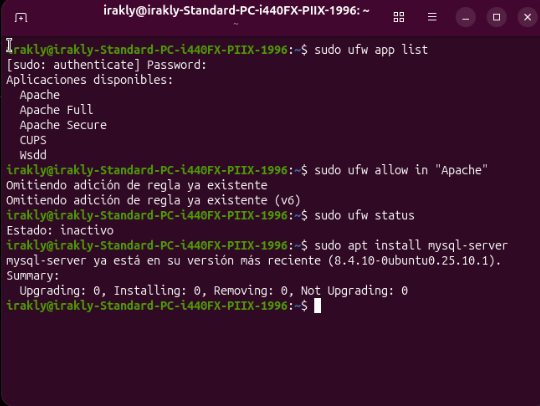

## 2. Instalación de MySQL

```bash
sudo apt install mysql-server
```

Ejecutamos el asistente de seguridad:

```bash
sudo mysql_secure_installation
```

Entramos en la consola de MySQL:

```bash
sudo mysql
```


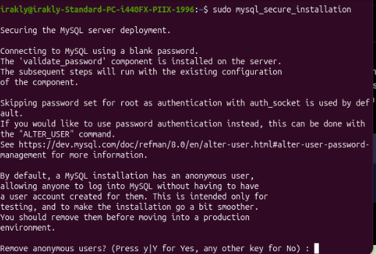
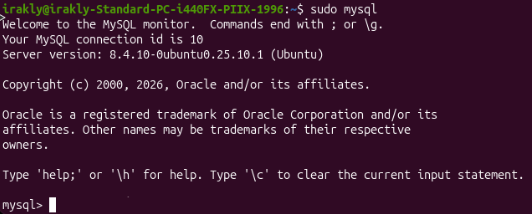
## 3. Instalación de PHP

Instalamos PHP, el módulo de Apache y el conector con MySQL:

```bash
sudo apt install php libapache2-mod-php php-mysql
```

Comprobamos la versión instalada:

```bash
php -v
```
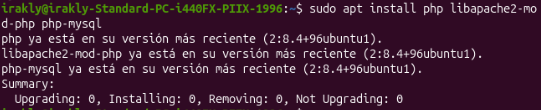
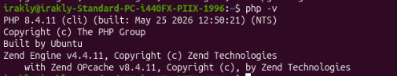

## 4. Creación del Virtual Host

Creamos el directorio del sitio y asignamos la propiedad a nuestro usuario:

```bash
sudo mkdir /var/www/irakly
sudo chown -R $USER:$USER /var/www/irakly
```

Creamos el archivo de configuración:

```bash
sudo nano /etc/apache2/sites-available/irakly.conf
```

Contenido:

```apache
<VirtualHost *:80>
    ServerName irakly
    ServerAlias www.irakly
    ServerAdmin webmaster@localhost
    DocumentRoot /var/www/irakly
    ErrorLog ${APACHE_LOG_DIR}/error.log
    CustomLog ${APACHE_LOG_DIR}/access.log combined
</VirtualHost>
```

Habilitamos el nuevo sitio y deshabilitamos el de por defecto:

```bash
sudo a2ensite irakly
sudo a2dissite 000-default
```

Comprobamos la sintaxis y recargamos Apache:

```bash
sudo apache2ctl configtest
sudo systemctl reload apache2
```

Creamos una página de prueba:

```bash
echo '<h1>Hola desde irakly</h1>' > /var/www/irakly/index.html
```

Para que PHP tenga prioridad sobre HTML, editamos el índice de directorio:

```bash
sudo nano /etc/apache2/mods-enabled/dir.conf
```

Dejamos `index.php` en primer lugar:

```apache
<IfModule mod_dir.c>
    DirectoryIndex index.php index.html index.cgi index.pl index.xhtml index.htm
</IfModule>
```

Recargamos de nuevo:

```bash
sudo systemctl reload apache2
```

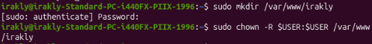
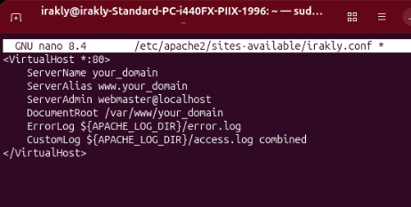
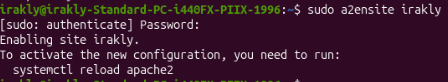
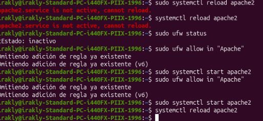
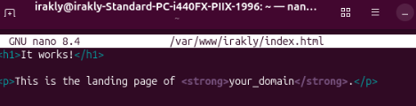
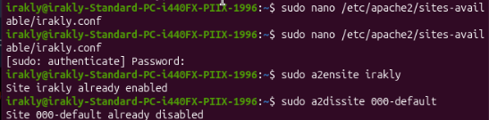
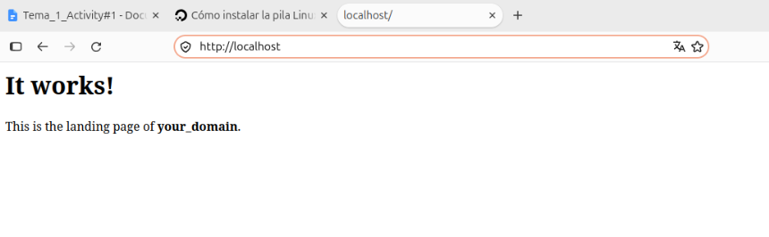


## 5. Prueba del procesamiento de páginas PHP

Creamos un archivo PHP de prueba:

```bash
nano /var/www/your_domain/info.php
```

```php
<?php
phpinfo();
```

Accedemos desde el navegador a `http://IP_DEL_SERVIDOR/info.php`. Debe mostrarse la tabla de información de PHP.
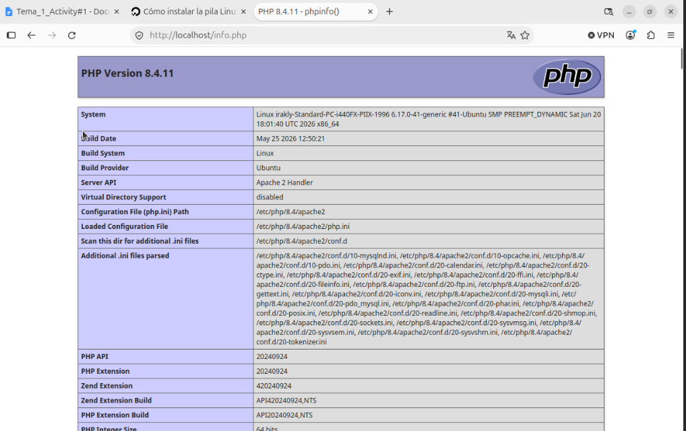

Por seguridad, eliminamos el archivo una vez comprobado, ya que expone información del servidor:

```bash
sudo rm /var/www/irakly/info.php
```

## 6. Prueba de la conexión con la base de datos desde PHP

Creamos una base de datos de prueba y un usuario dedicado:

```bash
sudo mysql
```

```sql
CREATE DATABASE example_database;
CREATE USER 'example_user'@'%' IDENTIFIED WITH mysql_native_password BY 'contraseña_segura';
GRANT ALL ON example_database.* TO 'example_user'@'%';
exit
```

Entramos con el nuevo usuario y creamos una tabla con datos:

```bash
mysql -u example_user -p
```

```sql
SHOW DATABASES;

CREATE TABLE example_database.todo_list (
    item_id INT AUTO_INCREMENT,
    content VARCHAR(255),
    PRIMARY KEY(item_id)
);

INSERT INTO example_database.todo_list (content) VALUES ("Mi primer elemento importante");
INSERT INTO example_database.todo_list (content) VALUES ("Mi segundo elemento importante");

SELECT * FROM example_database.todo_list;
exit
```

Creamos el script PHP que consulta la tabla:

```bash
nano /var/www/your_domain/todo_list.php
```

```php
<?php
$user = "example_user";
$password = "contraseña_segura";
$database = "example_database";
$table = "todo_list";

try {
    $db = new PDO("mysql:host=localhost;dbname=$database", $user, $password);
    echo "<h2>TODO</h2><ol>";
    foreach ($db->query("SELECT content FROM $table") as $row) {
        echo "<li>" . $row['content'] . "</li>";
    }
    echo "</ol>";
} catch (PDOException $e) {
    print "Error!: " . $e->getMessage() . "<br/>";
    die();
}
```

Accedemos a `http://IP_DEL_SERVIDOR/todo_list.php`. Debe mostrarse la lista con los elementos insertados, lo que confirma la conexión PHP ↔ MySQL.

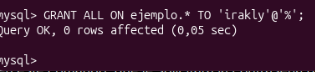
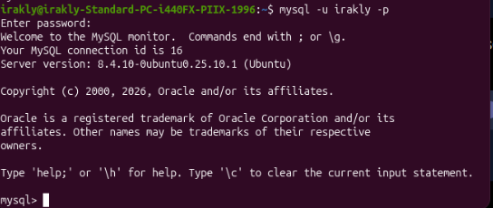
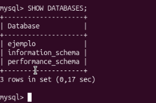
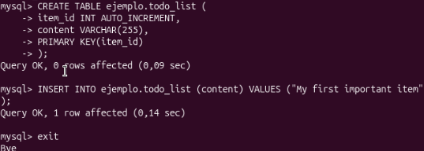


## 8. Conclusiones

Se ha instalado y configurado una pila LAMP completa en Ubuntu: Apache como servidor web, MySQL como gestor de base de datos y PHP como lenguaje de servidor. Se ha creado un Virtual Host independiente, se ha comprobado el procesamiento de PHP y la conexión a MySQL desde PHP, y finalmente se ha devuelto el servidor a su configuración por defecto.
